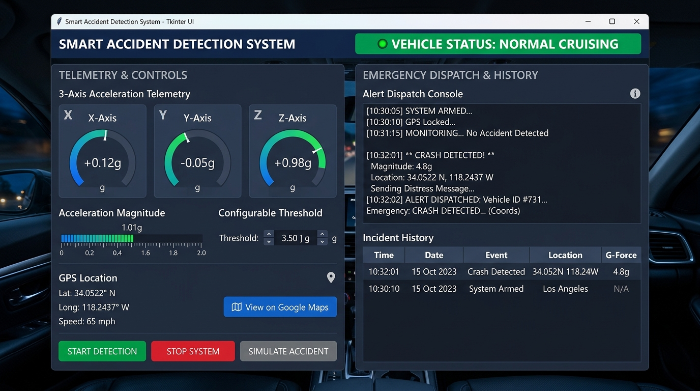

# Smart Accident Detection and Emergency Alert System Using Python

[](https://www.python.org/)
[]()
[](LICENSE)
[]()
[]()

> **CRITICAL ACADEMIC DISCLAIMER**:  
> This project is strictly a **SOFTWARE-ONLY SIMULATION** developed for educational and academic evaluation in Electronics and Communication Engineering (ECE). It **does NOT** use physical hardware (e.g., ESP32, Arduino, MPU6050, breadboards) and **does NOT** transmit physical SMS messages or connect to real cellular networks. All accelerometer readings, GPS coordinates, and distress messages are mathematically simulated.

---

## 📸 Dashboard Preview



---

## 1. Abstract

Timely medical intervention during the **"Golden Hour"** following a vehicular accident is critical for saving human lives. In many road accidents, injured occupants cannot call for assistance due to loss of consciousness or severe vehicle damage. This project presents a software-only simulation of a **Smart Accident Detection and Emergency Alert System** built using Python and Tkinter. The application simulates 3-axis acceleration telemetry, calculates total acceleration vector magnitude, executes a multi-sample digital filtering algorithm to suppress false alarms (such as road bumps), and identifies severe vehicle impacts. Upon accident detection, the system freezes simulated GPS coordinates, generates a hyperlinked Google Maps location URL, composes an emergency distress notification, and records the event in a persistent CSV incident log.

---

## 2. Introduction

Automotive safety and intelligent telematics are key focus areas in modern Electronics and Communication Engineering (ECE). Before deploying embedded hardware into automotive vehicles, engineering teams validate signal processing algorithms and threshold boundaries through software simulation. This project bridges digital signal processing concepts with practical desktop application design, providing undergraduate engineering students with an intuitive, zero-cost, and robust software implementation.

---

## 3. Problem Statement

1. **Unconscious Victims**: Incapacitated accident victims cannot manually contact emergency services.
2. **Geographical Ambiguity**: Emergency dispatchers lose valuable minutes attempting to pinpoint accident sites without exact coordinates.
3. **False Alarms**: Simple single-threshold detectors trigger erroneous alerts when a vehicle traverses speed breakers, potholes, or experiences sudden braking.

---

## 4. Objectives

- Simulate realistic 3-axis vehicular acceleration data ($X, Y, Z$).
- Compute scalar acceleration magnitude: $A = \sqrt{X^2 + Y^2 + Z^2}$.
- Implement a consecutive-sample digital filter to eliminate road-bump false alarms.
- Generate dynamic simulated GPS coordinates and clickable Google Maps navigation links.
- Synthesize simulated emergency alert dispatch messages.
- Maintain persistent accident history in CSV format.
- Provide a clean, modern, dark-blue Tkinter GUI dashboard.

---

## 5. Key Features

- **Live 3-Axis Telemetry**: Real-time readouts of lateral ($X$), longitudinal ($Y$), and vertical ($Z$) forces in $\text{m/s}^2$.
- **Orientation-Independent Detection**: 3D Euclidean magnitude ensures detection even if the vehicle rolls or spins.
- **2-Stage Digital Filtering**: Requires 2 consecutive high-acceleration samples before confirming an accident, discarding single-frame road bumps.
- **Dynamic Graphic Level Meter**: Real-time Canvas-rendered acceleration gauge with safe, warning, and critical color zones.
- **Configurable Thresholds**: User-adjustable impact threshold (Default: $25.0\text{ m/s}^2$).
- **Simulated GPS & Geonavigation**: Active coordinates that advance during transit and freeze upon crash confirmation.
- **Clickable Google Maps Integration**: Direct button to launch location in the default web browser or copy link to clipboard.
- **CSV Incident Logging**: Persistent incident history with date, time, peak force, and coordinates.
- **Zero External Dependencies**: Runs out of the box using standard Python built-ins!

---

## 6. Software Requirements & Technologies

### Requirements
- **Operating System**: Windows 10/11, macOS, or Linux.
- **Python**: Version 3.8 or higher.
- **Dependencies**: Built entirely using Python standard libraries (no `pip install` required).

### Technologies Used
| Technology / Module | Purpose |
| :--- | :--- |
| **Python 3** | Core programming language. |
| **Tkinter & TTK** | Graphical User Interface and modern widgets. |
| **Tkinter Canvas** | Custom dynamic visual acceleration level meter. |
| **math** | Vector magnitude computation ($A = \sqrt{X^2 + Y^2 + Z^2}$). |
| **csv** | Persistent tabular accident history storage. |
| **datetime** | Precise timestamping for incident logs. |
| **random** | Kinematic telemetry and GPS drift simulation. |
| **webbrowser** | Opening simulated coordinates in Google Maps. |

---

## 7. Working Principle

```text
+---------------------+     +-------------------------+     +-------------------------+
| SENSOR SIMULATOR    |     | ACCIDENT DETECTOR       |     | GPS SIMULATOR           |
| Generates simulated | ──► | Calculates magnitude A  |     | Tracks latitude,        |
| 3-axis acceleration |     | Checks threshold & filter|    | longitude, and speed    |
+---------------------+     +-------------------------+     +-------------------------+
                                         │                               │
                                         ▼                               ▼
                            +---------------------------------------------------------+
                            | DECISION ENGINE                                         |
                            | • A < 18 m/s²: NORMAL (Emerald Green)                   |
                            | • 18 <= A < Threshold: WARNING (Amber Yellow)           |
                            | • A >= Threshold (>= 2 samples): ACCIDENT (Crimson Red) |
                            +---------------------------------------------------------+
                                         │
                                         ▼
                            +---------------------------------------------------------+
                            | DISPATCH & LOGGING                                      |
                            | 1. Freeze GPS position                                  |
                            | 2. Generate Google Maps link                            |
                            | 3. Synthesize Emergency Alert Message                   |
                            | 4. Append record to 'data/accident_history.csv'         |
                            +---------------------------------------------------------+
```

---

## 8. Mathematical Formula

The total acceleration magnitude ($A$) is calculated using the 3D Euclidean vector norm:

$$A = \sqrt{X^2 + Y^2 + Z^2}$$

- $X$: Lateral acceleration ($\text{m/s}^2$)
- $Y$: Longitudinal acceleration ($\text{m/s}^2$)
- $Z$: Vertical acceleration ($\text{m/s}^2$)

Equivalent $g$-force is calculated by dividing by standard gravity ($g_0 = 9.80665\text{ m/s}^2$):

$$g = \frac{A}{9.80665}$$

---

## 9. Algorithm

```text
1. Initialize threshold = 25.0 m/s², consecutive_count = 0, consecutive_required = 2
2. At every telemetry interval (400 ms):
   a. Sample current X, Y, Z from SensorSimulator
   b. Compute Magnitude A = sqrt(X^2 + Y^2 + Z^2)
   c. Update simulated GPS latitude, longitude, and speed
   d. If A >= threshold:
         Increment consecutive_count by 1
         If consecutive_count >= consecutive_required:
            Status = ACCIDENT_DETECTED
            Freeze GPS coordinates
            Generate Emergency Alert message
            Log event to accident_history.csv
            Update GUI to Red Alert mode
         Else:
            Status = WARNING
            Update GUI to Yellow Warning mode
      Else if A >= 18.0:
         consecutive_count = 0
         Status = WARNING
      Else:
         consecutive_count = 0
         Status = NORMAL
         Update GUI to Green Normal mode
   e. Refresh UI readouts and acceleration level meter
```

---

## 10. Repository Structure

```text
Smart-Accident-Detection-System/
├── README.md               # Main Project Documentation
├── LICENSE                 # MIT License
├── .gitignore              # Standard Python ignore rules
├── software/
│   ├── README.md           # Software-specific technical manual
│   ├── requirements.txt    # Software dependencies specification
│   ├── main.py             # Primary Tkinter Dashboard GUI
│   ├── accident_detection.py# DSP Core: Magnitude & Consecutive Filter
│   ├── sensor_simulator.py # Kinematics Simulator (X, Y, Z Acceleration)
│   ├── gps_simulator.py    # Simulated GPS Coordinates & Maps Link
│   ├── alert_manager.py    # Alert Dispatch Composer & CSV Logger
│   ├── test_system.py      # Automated Test Suite (Validation & Viva Demo)
│   ├── data/
│   │   ├── sample_sensor_data.csv  # Pre-recorded driving & crash telemetry
│   │   └── accident_history.csv    # Persistent CSV incident history
│   └── screenshots/
│       ├── README.md       # Visual UI layout and color guide
│       └── dashboard_preview.png # Graphical preview of the software UI
└── docs/
    └── PROJECT_REPORT.md   # Comprehensive ECE College Mini-Project Report
```

---

## 11. Installation & How to Run

### Step 1: Clone or Open the Repository
```bash
git clone https://github.com/your-username/Smart-Accident-Detection-System.git
cd Smart-Accident-Detection-System
```

### Step 2: Verify Python Environment
Ensure Python 3.8+ is installed:
```bash
python --version
```

### Step 3: Run the Application
```bash
# Execute from the software directory
cd software
python main.py

# Or run directly from repository root
python software/main.py
```

### Step 4: Run Automated Tests
```bash
python software/test_system.py
```

---

## 12. Expected Output

### Normal Cruising State
- **Status Banner**: Emerald Green (`VEHICLE STATUS: NORMAL CRUISING`)
- **Magnitude**: $\approx 9.8\text{ m/s}^2$ ($1.00\text{ g}$)
- **Speed**: $45\text{--}60\text{ km/h}$

### Road Bump Encounter (Filter Verification)
- **Status Banner**: Amber Yellow (`WARNING: ELEVATED G-FORCE / ROAD ANOMALY`)
- **Filter**: Consecutive sample count resets; no false accident is logged!

### Simulated Accident State
- **Status Banner**: Crimson Red (`CRITICAL: VEHICLE ACCIDENT DETECTED!`)
- **Emergency Dispatch Box**: Displays synthesized distress dispatch:
  ```text
  ==========================================================
  🚨 [SIMULATED EMERGENCY ALERT] VEHICLE COLLISION DETECTED
  ==========================================================
  • Incident Timestamp : 2026-10-30 21:15:00
  • Impact Magnitude   : 48.50 m/s² (4.95 g)
  • Severity Level     : CRITICAL IMPACT
  ----------------------------------------------------------
  SIMULATED GPS LOCATION:
  • Latitude           : 12.971620° N
  • Longitude          : 77.594630° E
  • Google Maps Link   : https://www.google.com/maps?q=12.971620,77.594630
  ----------------------------------------------------------
  SIMULATED DISPATCH ACTIONS:
  ✔ Automated Emergency Services Notification (Simulated)
  ✔ Primary Family Contacts Alert Broadcast (Simulated)
  ✔ GPS Telemetry Saved to Local Incident Log
  ==========================================================
  [ACADEMIC NOTE]: This is a software simulation. No physical
  SMS or cellular network transmission was made.
  ==========================================================
  ```
- **Incident History Table**: Appends new record to CSV and displays in table.

---

## 13. Applications

- **Academic Learning**: Teaches ECE students vehicular telemetry, vector mathematics, and digital filtering.
- **Fleet Management Systems**: Telematics software for monitoring reckless driving and sudden decelerations.
- **Connected Vehicle Research**: Prototype software layer for automotive electronic control units (ECUs).

---

## 14. Limitations

- **Software Simulation**: Accelerometer readings and GPS telemetry are mathematically synthesized.
- **No Physical Cellular Transmission**: Emergency alerts are displayed in the GUI and recorded in CSV; no physical SMS is sent.
- **Suspension Dynamics**: Does not simulate vehicle chassis structural deformation or elasticity.

---

## 15. Future Enhancements

- Interfacing with physical hardware (MPU6050 accelerometer, ESP32 microcontroller, Neo-6M GPS).
- Adding a GSM module (SIM800L) for real cellular SMS transmission.
- Machine learning crash classification (rollover vs. head-on impact).
- Cloud IoT telemetry logging via MQTT/HTTP.

---

## 16. Conclusion

The **Smart Accident Detection and Emergency Alert System** provides a complete, reliable, and accessible software-only simulation of automotive crash detection. By coupling Euclidean vector norm calculation with consecutive-sample temporal filtering, the system successfully distinguishes true crash events from road irregularities, demonstrating the core principles of intelligent automotive telematics.

---

## 17. Author & Project Information

- **Project Title**: Smart Accident Detection and Emergency Alert System Using Python
- **Department**: Department of Electronics and Communication Engineering (ECE)
- **Year**: 2026
- **License**: [MIT License](LICENSE)
