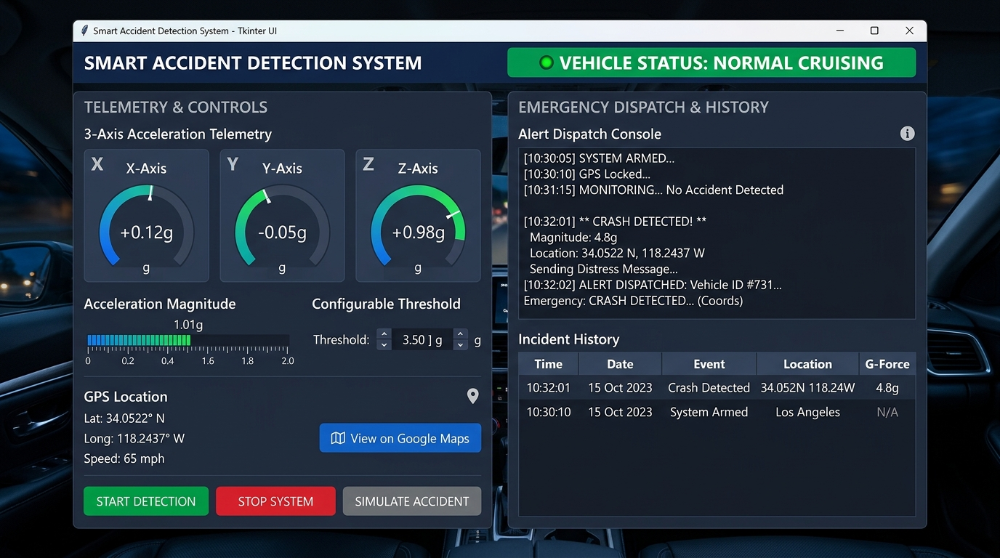

# Application Screenshots & UI Showcase

This directory contains visual previews and layout documentation of the **Smart Accident Detection and Emergency Alert System** graphical user interface.

## Dashboard Preview



## Visual Architecture & UI Component Map

```text
+----------------------------------------------------------------------------------------------------+
|  SMART ACCIDENT DETECTION & EMERGENCY ALERT SYSTEM      [SOFTWARE-ONLY SIMULATION - NO HARDWARE]   |
+----------------------------------------------------------------------------------------------------+
|                                                                                                    |
|  [ LEFT PANEL: TELEMETRY & CONTROLS ]              [ RIGHT PANEL: ALERTS & HISTORY ]               |
|                                                                                                    |
|  +-----------------------------------------------+ +---------------------------------------------+ |
|  | VEHICLE STATUS: NORMAL CRUISING (Green)       | | EMERGENCY ALERT DISPATCH TRANSMISSION       | |
|  +-----------------------------------------------+ | +-----------------------------------------+ | |
|  | ACCELERATION TELEMETRY (Simulated Sensors)    | | | [SIMULATED EMERGENCY ALERT]             | | |
|  |  [ X: +0.12 m/s² ] [ Y: -0.05 m/s² ]          | | | Crash Impact: 45.20 m/s² (4.61 g)       | | |
|  |  [ Z: +9.81 m/s² (Gravity) ]                  | | | GPS Lat: 12.971620 N, Lon: 77.594630 E  | | |
|  |                                               | | | Google Maps: https://maps.google.com/.. | | |
|  | Total Magnitude A: 9.81 m/s² (1.00 g)         | | +-----------------------------------------+ | |
|  | [|||||||||||||||||-------------------------]  | +---------------------------------------------+ |
|  | Threshold: [25.0] m/s² | Consecutive: 2       |                                                 |
|  +-----------------------------------------------+ +---------------------------------------------+ |
|  | SIMULATED GPS LOCATION                        | | ACCIDENT INCIDENT HISTORY (CSV Storage)     | |
|  | Latitude:  12.971598° N                       | | Timestamp        Mag(m/s²) Status    GPS    | |
|  | Longitude: 77.594566° E                       | | 2026-10-30 21:15 45.20     ACCIDENT  12.97..| |
|  | Speed: 52.0 km/h | Status: Active Track       | |                                             | |
|  | [ Open in Google Maps ] [ Copy Link ]         | | [ Clear Incident History ] [ Map Selected ] | |
|  +-----------------------------------------------+ +---------------------------------------------+ |
|  | SYSTEM CONTROL PANEL                          |                                                 |
|  | [▶ Start Monitoring] [⏹ Stop Monitoring]     |                                                 |
|  | [💥 Simulate Accident] [🔄 Reset System]       |                                                 |
|  +-----------------------------------------------+                                                 |
|                                                                                                    |
+----------------------------------------------------------------------------------------------------+
| Status: Active Monitoring | Telemetry Rate: 2.5 Hz | Filter: 2-Stage Consecutive Verification     |
+----------------------------------------------------------------------------------------------------+
```

## Status Color Indicators

| Status | Color | RGB Hex | Condition |
| :--- | :--- | :--- | :--- |
| **Normal Cruising** | Emerald Green | `#10b981` | Magnitude $A < 18.0 \text{ m/s}^2$ |
| **Warning / Bump** | Amber Yellow | `#f59e0b` | $18.0 \le A < \text{Threshold}$ OR single spike |
| **Accident Confirmed** | Crimson Red | `#ef4444` | $A \ge \text{Threshold}$ for $\ge 2$ consecutive readings |
